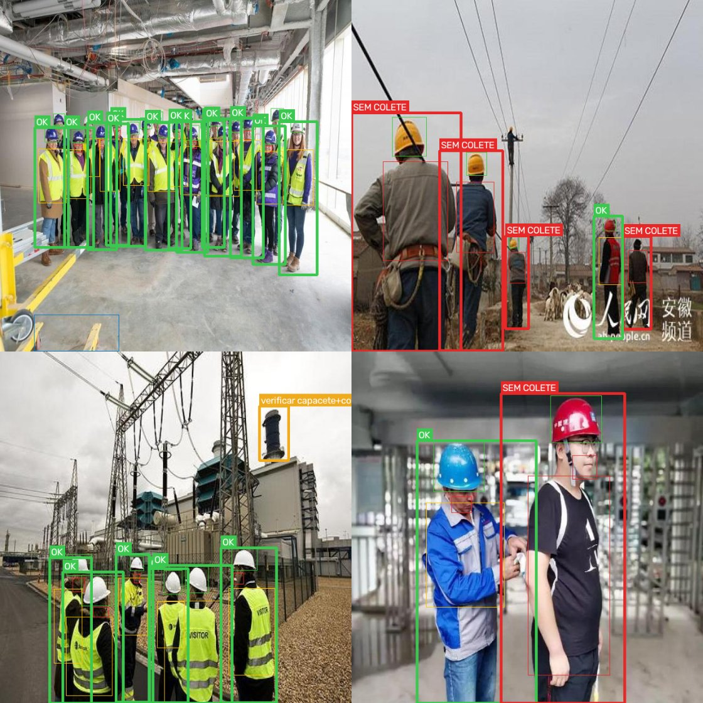
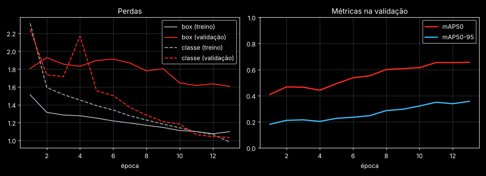

<div align="center">

# 🦺 EPI Vision

**Detecção de Equipamentos de Proteção Individual com YOLO11 e regra de conformidade por trabalhador.**

[](https://github.com/SaMoCaSa00/epi-vision/actions/workflows/tests.yml)




</div>

## O problema

Em canteiro de obra, subestação ou chão de fábrica, a fiscalização de capacete e colete (NR-6) é feita no olho.
Um detector de objetos comum responde *"tem um 'sem capacete' na imagem"*. Isso não basta pra uma fiscalização, que precisa saber **quem** está irregular e **o que falta** pra essa pessoa.

## O que o EPI Vision faz

1. **Detecta** pessoas, capacetes, coletes, máscaras (e a ausência deles), cones, máquinas e veículos com um **YOLO11n** treinado pra isso.
2. **Liga cada EPI a uma pessoa**. O capacete conta pra pessoa cuja *região da cabeça* contém o centro da caixa, e o colete pra pessoa cujo *tronco* contém o centro. Um capacete no chão, ao lado do pé de alguém, **não** conta.
3. **Decide a situação de cada trabalhador**: ✅ conforme · ❌ sem o EPI · ❔ não visível (de costas ou cortado). Você escolhe se "não visível" conta como irregular.
4. **Em vídeo**, rastreia cada pessoa com um ID (rastreador por IoU) e conta **pessoas** irregulares, não quadros. Uma pessoa só vira irregular depois de aparecer assim em pelo menos 3 quadros, o que filtra erros de um quadro só.
5. Gera um **relatório CSV** por trabalhador.

O modelo roda em **ONNX Runtime na CPU** (≈10 MB, sem PyTorch), então o app sobe em qualquer máquina.

## Resultados

Modelo treinado com 13 épocas, imagens de 416 px, na CPU. Números do **conjunto de teste** (82 imagens que o modelo não viu no treino):

| mAP50 | mAP50-95 | Precisão | Recall |
|:-----:|:--------:|:--------:|:------:|
| **0,58** | 0,30 | 0,71 | 0,53 |

| Classe | mAP50 | Classe | mAP50 |
|---|:-:|---|:-:|
| Capacete | 0,78 | Sem capacete | 0,42 |
| Colete | 0,68 | Sem colete | 0,62 |
| Máscara | 0,73 | Sem máscara | 0,29 |
| Pessoa | 0,71 | Máquina | 0,77 |

<p align="center"></p>

**Limitações:** as classes "sem EPI" são as mais difíceis, porque a ausência de um objeto é menos visual que a presença dele. Por isso a regra de conformidade usa as duas pistas: "sem capacete" detectado **ou** nenhum capacete na cabeça. O treino foi curto e na CPU. Com GPU e mais épocas (ou o YOLO11s), as métricas sobem. Isto é um projeto de portfólio, não um sistema de segurança certificado.

## Rodando

```bash
git clone https://github.com/SaMoCaSa00/epi-vision.git
cd epi-vision
pip install -r requirements.txt
streamlit run app.py
```

No app dá pra enviar foto, usar a câmera, escolher um exemplo ou mandar um vídeo curto.

### Testes

```bash
pip install -r requirements-dev.txt
pytest
```

Os testes cobrem a regra de conformidade (capacete na cabeça × no pé, EPI indo pra pessoa certa, violação sem pessoa detectada), o decodificador do YOLO, o NMS e o rastreador.

### Treinando de novo

```bash
pip install -r requirements-train.txt
python train/train.py --data /caminho/do/Dataset --epochs 30 --imgsz 512
```

O script treina, avalia na validação e no teste, exporta pra ONNX e grava `models/epi_yolo11n.json` com as métricas que o app mostra.

## Estrutura

```
epi/
  detector.py     # pré-processamento (letterbox), inferência ONNX, decodificação YOLO11 + NMS
  compliance.py   # liga EPI → pessoa por região do corpo e decide a situação de cada um
  video.py        # rastreador por IoU + processamento de vídeo
  draw.py         # anotação das imagens
app.py            # interface Streamlit
train/train.py    # treino + avaliação + exportação ONNX
tests/            # pytest
```

## Dados

Treinado com o **[Construction Site Safety Dataset](https://universe.roboflow.com/roboflow-universe-projects/construction-site-safety)** (Roboflow Universe), 10 classes: 2.605 imagens de treino, 114 de validação e 82 de teste. As imagens de exemplo em `samples/` vêm do conjunto de teste desse dataset. Os créditos das imagens são dos autores originais.

## Autor

**Samuell Moura**, estudante de Engenharia de Computação (UFU).
[LinkedIn](https://www.linkedin.com/in/samuell-carreiro/) · [GitHub](https://github.com/SaMoCaSa00)

Licença MIT (código). O dataset e o modelo base (Ultralytics YOLO11, AGPL-3.0) têm licenças próprias.
